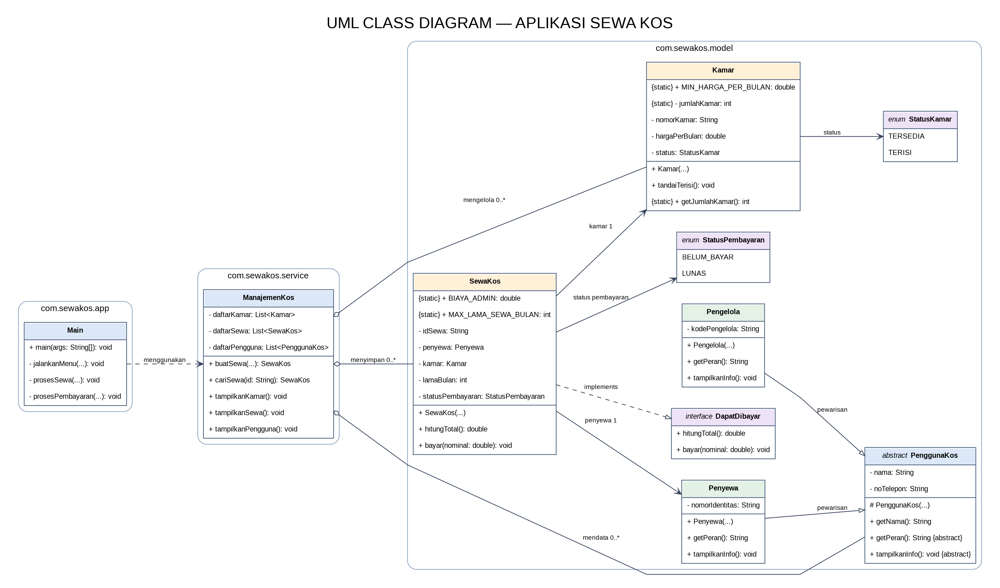

# **LAPORAN UTS PRAKTIKUM PEMROGRAMAN BERBASIS OBJEK**

| Informasi Proyek | Keterangan |
| :--- | :--- |
| **Mata Kuliah** | Praktikum Pemrograman Berbasis Objek (Prak-PBO) |
| **Kelas** | A |
| **PJ** | Naufal Maulana Saputra |
| **Tema** | Sewa Kos |
| **Tanggal** | 22 Oktober 2026 |
| **Nama** | Mochammad Jihan Isfalana |
| **NPM** | 4525210110 |

---

## Detail Pengerjaan & Anggota Kelompok

| Nama | NPM | Tugas / Fitur yang Dikerjakan |
| :--- | :--- | :--- |
| Mochammad Jihan Isfalana | 4525210110 | ManajemenKos.java, Main.java, dan PUML (Koordinator) |
| Khaira Rahma Apriliani | 4525210108 | Kamar.java |
| Abang Kevin Husein | 4525210102 | PenggunaKos.java & Pengelola.java |
| Aqsa Ibnu Rizik | 4525210103 | StatusKamar.java & StatusPembayaran.java |
| Farid Zhahir Muttaqin | 4525210105 | SewaKos.java |
| Haikal Putra Pratama | 4525210106 | DapatDibayar.java & README.md |
| Irvan Indra Mustafa | 4525210107 | Penyewa.java |

---

## Deskripsi

Aplikasi console untuk menampilkan kamar kos, mencatat penyewaan, menghitung tagihan, memproses pembayaran, dan menampilkan informasi pengguna. Data disimpan sementara selama program berjalan  aplikasi ini belum menggunakan database.

## Fitur

1. Menampilkan daftar kamar, harga, dan status.
2. Membuat transaksi sewa dengan validasi data penyewa, kamar, serta durasi sewa.
3. Menghitung tagihan berdasarkan harga kamar × durasi + biaya admin.
4. Memproses pembayaran dan menolak nominal tidak valid atau pembayaran kurang.
5. Menampilkan transaksi dan informasi pengguna.

## Struktur File

```text
SewaKosJava/
├── README.md
├── uml/
│   ├── SewaKosUML.puml
│   ├── SewaKosUML.dot
│   ├── SewaKosUML.png
│   └── SewaKosUML.svg
└── src/
    └── com/sewakos/
        ├── app/
        │   └── Main.java
        ├── model/
        │   ├── DapatDibayar.java
        │   ├── Kamar.java
        │   ├── Pengelola.java
        │   ├── PenggunaKos.java
        │   ├── Penyewa.java
        │   ├── SewaKos.java
        │   ├── StatusKamar.java
        │   └── StatusPembayaran.java
        └── service/
            └── ManajemenKos.java
```

## Konsep Materi Pertemuan 1–7

| Materi | Implementasi |
|---|---|
| GitHub | Seluruh source code berada dalam satu proyek/repository. Commit dan push dilakukan melalui Git. GitHub sendiri bukan fitur bahasa Java. |
| Kelas, objek, enkapsulasi | Kelas `Kamar`, `Penyewa`, `PenggunaKos`, dan `SewaKos`  atribut dibuat `private` serta diakses melalui getter/method. |
| Konstruktor, static, konstanta | Konstruktor memvalidasi objek  `Kamar.jumlahKamar`, `SewaKos.urutanSewa`, dan konstanta `BIAYA_ADMIN`, `MIN_HARGA_PER_BULAN`, `MAX_LAMA_SEWA_BULAN`. |
| Pewarisan | `Penyewa` dan `Pengelola` mewarisi `PenggunaKos`. |
| Polimorfisme | `ManajemenKos` menyimpan objek berbeda dalam `List<PenggunaKos>` dan memanggil `tampilkanInfo()` yang dioverride subclass. |
| Abstract, interface, enum | `PenggunaKos` adalah abstract class  `DapatDibayar` adalah interface  `StatusKamar` dan `StatusPembayaran` adalah enum. |
| Relasi objek | `SewaKos` memiliki referensi `Penyewa` dan `Kamar`  `ManajemenKos` mengelola kumpulan kamar, sewa, dan pengguna. |

## Validasi

Nilai yang tidak valid ditolak menggunakan `throw new Exception`, antara lain nama kosong, nomor telepon salah, nomor kamar tidak sesuai format, harga di bawah minimum, durasi di luar rentang 1–24 bulan, kamar tidak tersedia, nominal pembayaran tidak valid, pembayaran kurang, dan ID sewa tidak ditemukan.

### Cara Menjalankan

```powershell
javac -d out $files
java -cp out com.sewakos.app.Main
```

### Linux/macOS

```bash
javac -d out $(find src -name '*.java')
java -cp out com.sewakos.app.Main
```

## Alur Singkat

1. Pilih menu **1** untuk memeriksa kamar.
2. Pilih menu **2** untuk membuat sewa  catat ID sewa yang ditampilkan.
3. Pilih menu **3** untuk membayar berdasarkan ID sewa.
4. Pilih menu **4** untuk melihat transaksi atau **5** untuk melihat polimorfisme pengguna.
5. Pilih menu **0** untuk keluar.

Tagihan dihitung dengan rumus: **(harga kamar per bulan × lama sewa) + biaya admin Rp50.000**.

## Diagram UML



---

## 1. Implementasi Java

### 1.1. File: `Satu.java`
**Penjelasan Kode:**
> [Isi Penjelasan mengenai fungsi file ini dan konsep OOP yang diterapkan.]

**Screenshot Kode:**


### 1.2. File: `Dua.java`
**Penjelasan Kode:**
> [Isi Penjelasan.]

**Screenshot Kode:**


### 1.3. File: `Main.java`
**Penjelasan Kode:**
> [Isi Penjelasan mengenai alur eksekusi program utama.]

**Screenshot Kode:**


### Output
**Hasil Running Program (Java):**


---

## 3. Kesimpulan

Jadi kesimpulannya, pada aplikasi Sewa Kos iniii merupakan sebuah console application berbasis Java yang berhasil mengintegrasikan seluruh konsep dasar Pemrograman Berbasis Objek (PBO) dari Pertemuan 1 hingga 7 secara terstruktur dan terintegrasi. 

Berikut adalah ringkasan utama dari proyek ini:

1. **Penerapan Konsep PBO secara Utuh:**
   * **Enkapsulasi:** Menggunakan atribut private pada kelas utama (Kamar, Penyewa, SewaKos) dengan akses data melalui *getter dan method.
   * **Konstruktor, Static, & Konstanta:** Menggunakan konstruktor untuk validasi awal, variabel static untuk penomoran otomatis, serta konstanta seperti BIAYA_ADMIN (Rp50.000).
   * **Pewarisan (Inheritance):** Menurunkan atribut dasar dari *abstract class PenggunaKos ke subclass Penyewa dan Pengelola.
   * **Polimorfisme:** Mengelola berbagai tipe pengguna dalam satu List<PenggunaKos> dan memanggil pembaruan info melalui *override method tampilkanInfo().
   * **Abstract, Interface, & Enum:** Memanfaatkan *abstract class PenggunaKos, interface DapatDibayar, serta enum status (StatusKamar dan StatusPembayaran).

2. **Alur Transaksi & Perhitungan:**
   * Menangani alur sewa secara dinamis mulai dari pengecekan ketersediaan kamar, pembuatan transaksi sewa, kalkulasi tagihan otomatis dengan rumus (Harga Kamar × Lama Sewa + Biaya Admin), hingga pemrosesan pembayaran.

3. **Validasi Input & Penanganan Eksepsi:**
   * Menerapkan validasi data yang ketat menggunakan throw new Exception untuk memastikan seluruh input (seperti nomor telepon, durasi sewa 1–24 bulan, status kamar, dan kecukupan nominal pembayaran) valid sebelum diproses.

4. **Arsitektur & Dokumentasi:**
   * Kode program terstruktur rapi dengan pembagian package (app, model, service) serta dilengkapi diagram UML untuk mempermudah pemahaman alur dan pengembangan sistem ke depannya.
