# **Pertemuan 07 - Praktikum Pemrograman Berorientasi Objek (PBO)**

## Biodata Mahasiswa

- **Nama**: Mochammad Jihan Isfalana
- **NIM**: 4525210110
- **Kelas**: Praktikum PBO A

## Mata Kuliah dan Dosen

- **Mata Kuliah**: Pemrograman Berorientasi Objek
- **Dosen Pengampu**: Adi Wahyu Pribadi, S.Si., M.Kom.

---

## Tugas Pertemuan 07

**Materi**: Komposisi dan agregasi pada Java dan PHP, dengan studi kasus bagian
buku dan hubungan jurusan dengan mahasiswa.

Tugas yang dikerjakan:

1. Menerapkan komposisi `Buku` dan `Bab`: objek `Bab` dibuat oleh `Buku` dan tidak
   dapat dibuat dari luar pada versi Java.
2. Menjaga enkapsulasi koleksi bab dengan mengembalikan salinan yang tidak dapat
   diubah.
3. Menolak jumlah eksemplar negatif dan mencegah stok buku berkurang ketika
   sudah habis.
4. Menerapkan agregasi `Jurusan` dan `Mahasiswa`: mahasiswa dibuat dari luar,
   dapat didaftarkan, dikeluarkan, dan tetap hidup setelah keluar dari jurusan.
5. Membuat kerangka `PerpustakaanService` untuk menambah, mencari, meminjam,
   dan mengembalikan buku. Aturan layanan masih minimal dan akan dikembangkan
   pada sesi berikutnya.

---

## Pengerjaan Tugas, Penjelasan, dan Hasil

### 1. Kondisi Sebelum (Starter Code)

Kode awal tersedia di `src/starter/java` dan `src/starter/php`. Beberapa bagian
TODO masih kosong: validasi jumlah eksemplar, pembuatan `Bab`, pengembalian
koleksi yang tidak dapat diubah, pengurangan stok, serta operasi agregasi pada
`Jurusan`. File starter dipertahankan sebagai pembanding dan tidak diubah.

## PUML

### PUML Before

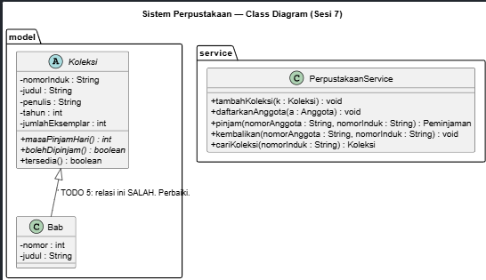

### PUML After

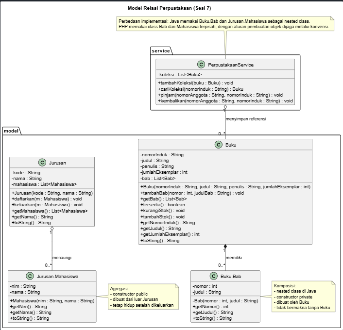

## Java

Starter Java berisi `Buku`, `Jurusan`, kelas bagian `Bab` dan `Mahasiswa`,
`PerpustakaanService`, serta `Main` sebagai penguji relasi.

### Running Java Before

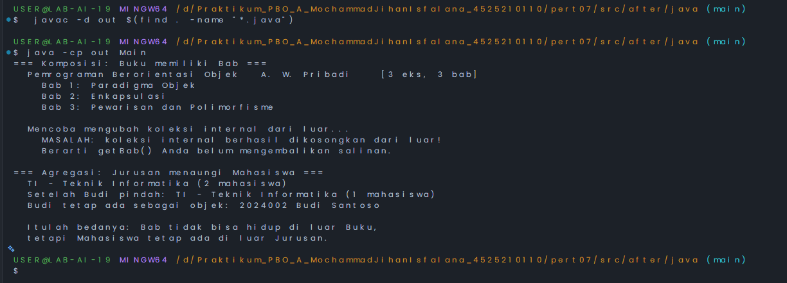

### Code Java Before

## 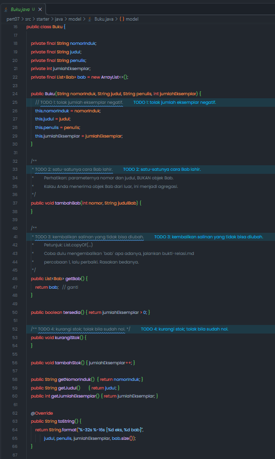

## 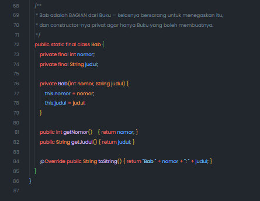

## 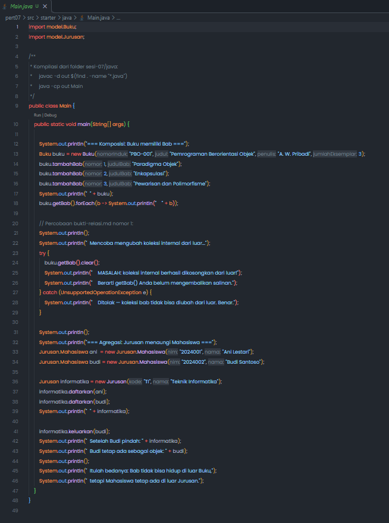

## 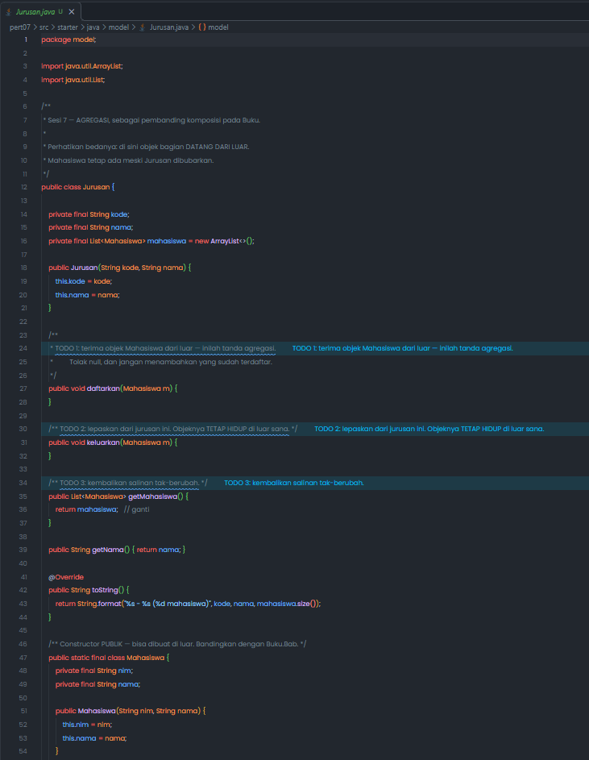

## 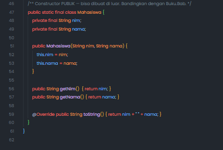

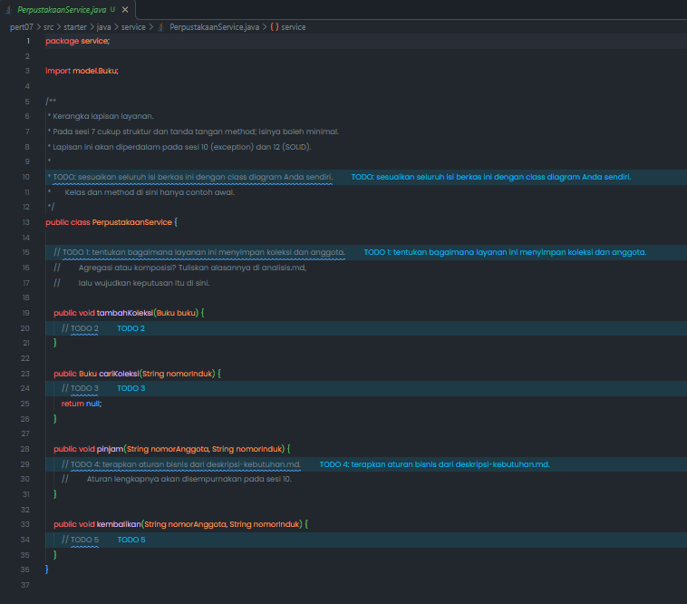

## PHP

Starter PHP berisi `relasi.php` dan `main.php`. Karena PHP tidak memiliki
nested class, batas pembuatan `Bab` sebagai komponen `Buku` dijaga melalui
konvensi: hanya `Buku::tambahBab()` yang digunakan untuk membuat `Bab`.

### Running PHP Before

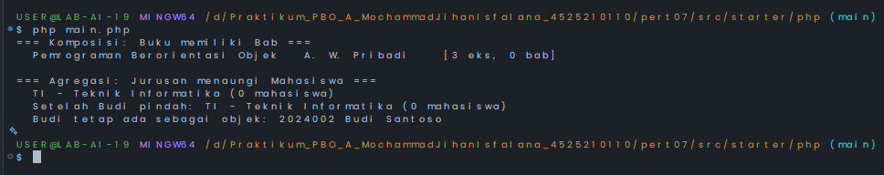

### Code PHP Before

## 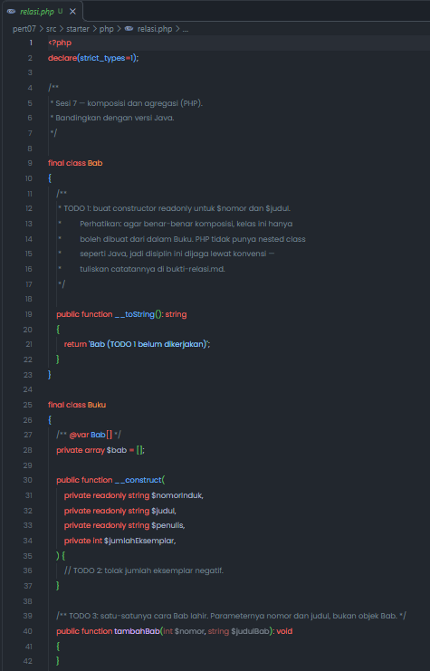

## 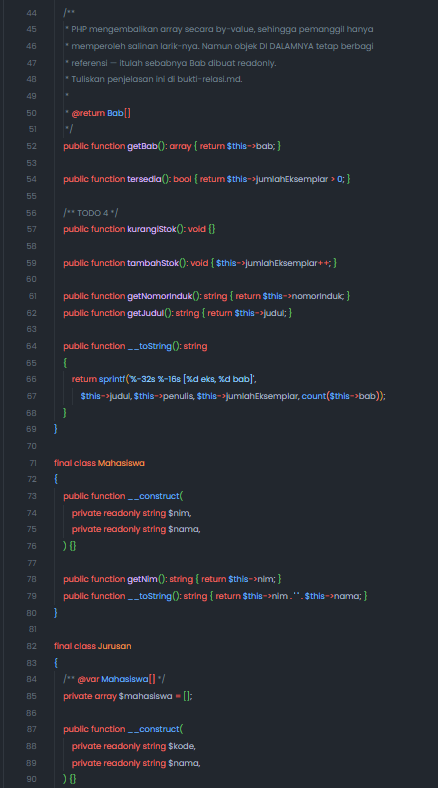

## 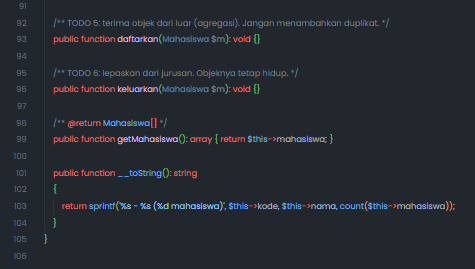

## 

### 2. Kondisi Sesudah (Implementasi)

## Java

| File                               | Penjelasan                                                                                                                                                                                                             |
| ---------------------------------- | ---------------------------------------------------------------------------------------------------------------------------------------------------------------------------------------------------------------------- |
| `model/Buku.java`                  | Menyimpan data buku dan daftar bab. Constructor menolak jumlah eksemplar negatif, `tambahBab()` membuat bab di dalam buku, `getBab()` mengembalikan `List.copyOf()`, dan operasi stok menjaga stok agar tidak negatif. |
| `model/Jurusan.java`               | Menyimpan mahasiswa yang berasal dari luar. `daftarkan()` menolak `null` dan duplikat, `keluarkan()` melepas mahasiswa tanpa mematikan objeknya, dan `getMahasiswa()` mengembalikan salinan tak dapat diubah.          |
| `service/PerpustakaanService.java` | Menyediakan kerangka penyimpanan koleksi buku, pencarian, peminjaman, dan pengembalian. Peminjaman mengurangi stok pengembalian menambah stok.                                                                         |
| `Main.java`                        | Membuktikan komposisi, perlindungan koleksi internal, agregasi, dan perbedaan siklus hidup `Bab` dengan `Mahasiswa`.                                                                                                   |

### Running Java After

**Sebelum PerpustakaanService dimasukkan**
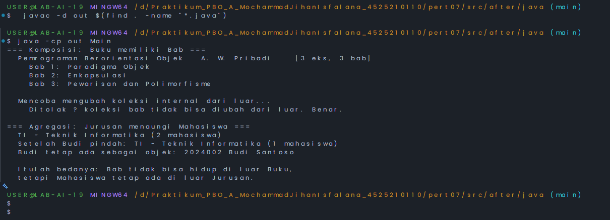
**Setelah PerpustakaanService dimasukkan ke Main.java**
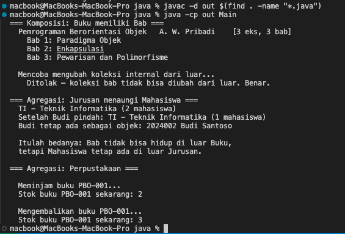

### Code Java After

## 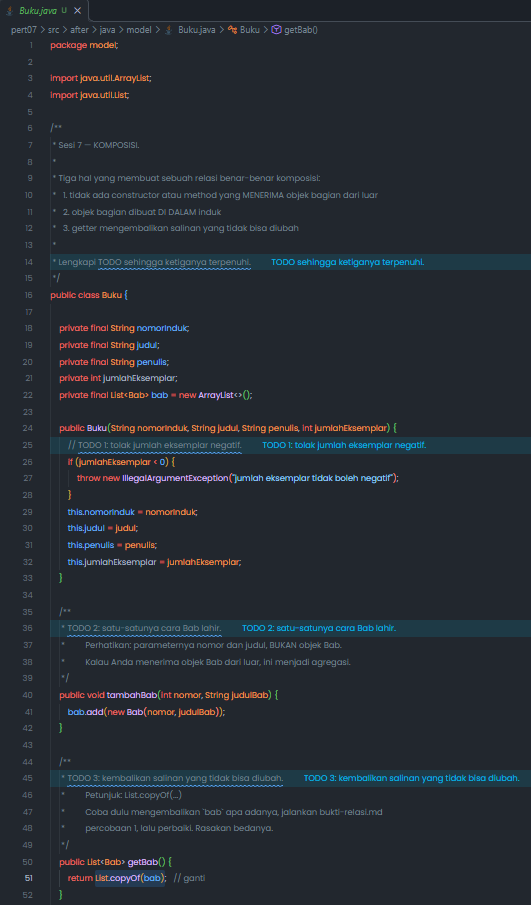

## 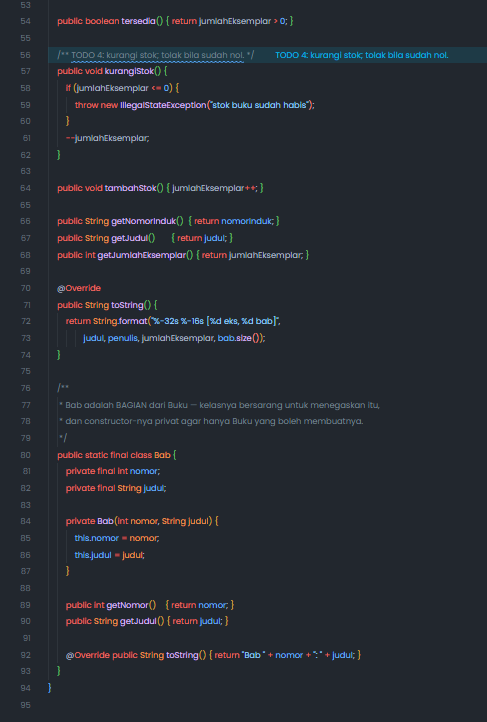

## 

## 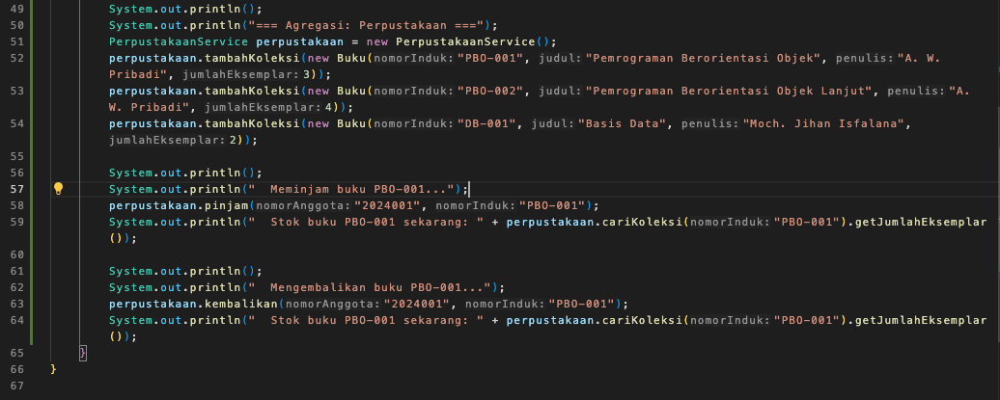

## 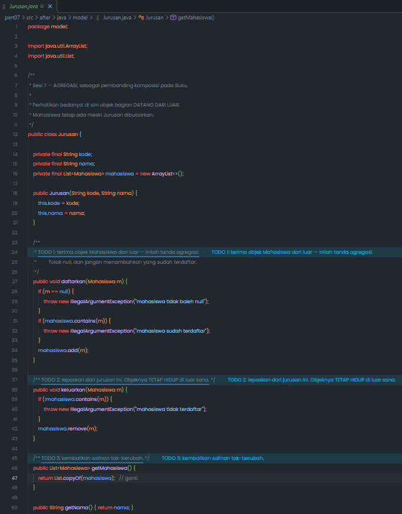

## 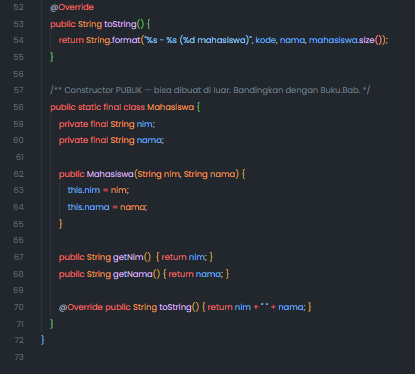

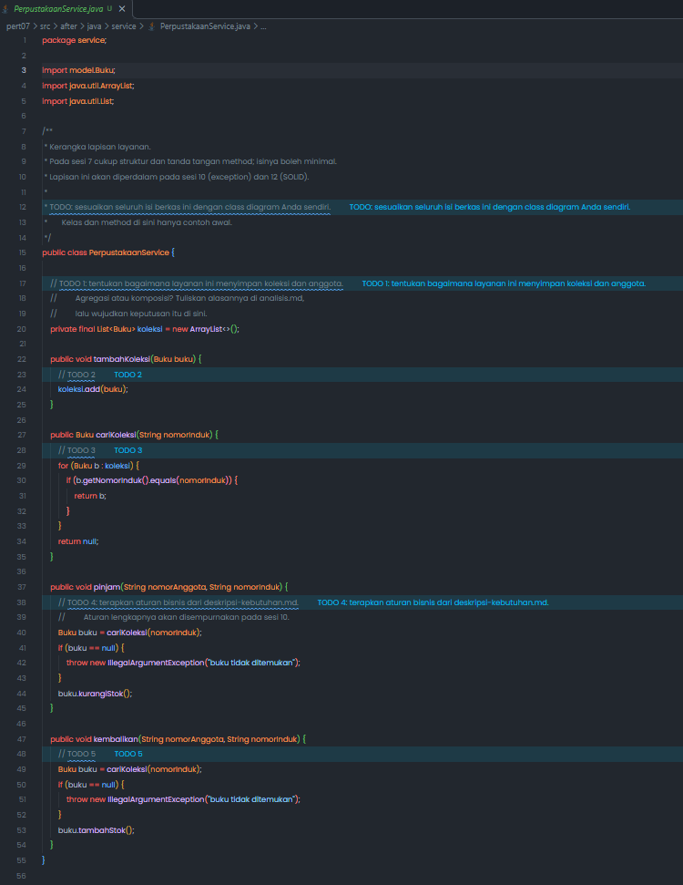

## PHP

| File         | Penjelasan                                                                                                                                                                                   |
| ------------ | -------------------------------------------------------------------------------------------------------------------------------------------------------------------------------------------- |
| `relasi.php` | Mendefinisikan `Bab`, `Buku`, `Mahasiswa`, dan `Jurusan` dengan properti `readonly`, validasi stok, komposisi melalui `tambahBab()`, serta agregasi melalui `daftarkan()` dan `keluarkan()`. |
| `main.php`   | Menjalankan demonstrasi komposisi buku-bab dan agregasi jurusan-mahasiswa.                                                                                                                   |

Perbedaan penting antara implementasi Java dan PHP adalah mekanisme
enkapsulasinya. Java menggunakan nested class dengan constructor `private` dan
`List.copyOf()`. PHP menggunakan class terpisah dengan constructor publik,
konvensi pemakaian, array yang dikembalikan berdasarkan nilai, dan objek `Bab`
yang memiliki properti `readonly` agar isinya tidak diubah melalui salinan array.

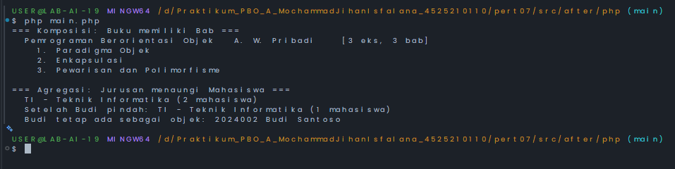

### Code PHP After

## 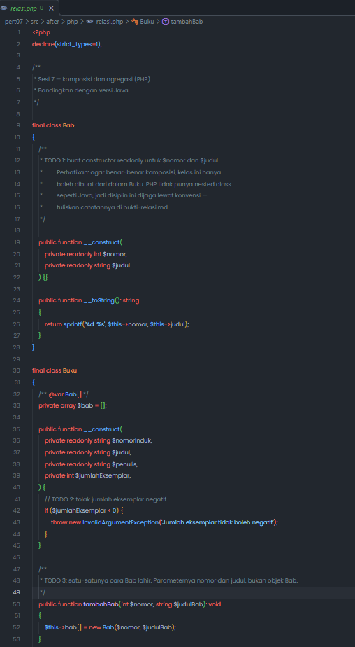

## 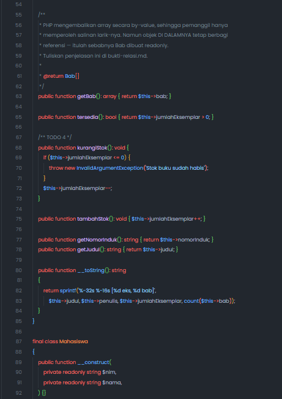

## 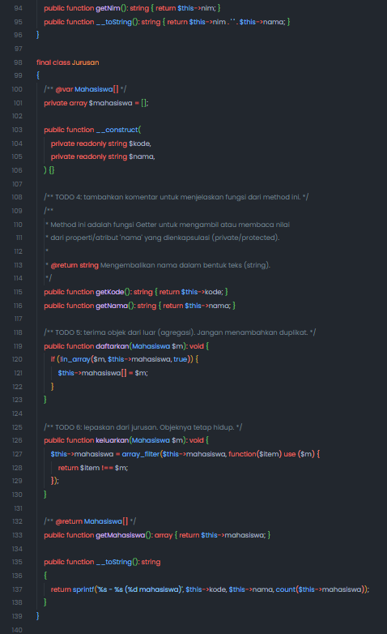

#### UML dan Deskripsi Kebutuhan

- [Class diagram PlantUML](./src/after/uml/perpustakaan-kerangka.puml) memodelkan
  kelas konseptual yang dipakai bersama oleh Java dan PHP.
- [Deskripsi kebutuhan](./src/after/deskripsi-kebutuhan.md) menjelaskan invariant,
  kata benda, kata kerja, dan alasan pemilihan komposisi atau agregasi.

### 3. Cara Menjalankan

#### Java

Dari folder `src/after/java`:

```bash
javac -d out $(find . -name "*.java")
java -cp out Main
```

#### PHP

Dari folder `src/after/php`:

```bash
php main.php
```

PHP membutuhkan versi 8.1 atau lebih baru karena kode memakai constructor
property promotion dan properti `readonly`.

### 4. Hasil Pengujian

Program Java dan PHP menampilkan:

- sebuah buku dengan tiga bab
- daftar bab yang berhasil ditampilkan
- mahasiswa Ani dan Budi terdaftar pada Jurusan Teknik Informatika
- setelah Budi dikeluarkan, objek Budi masih dapat digunakan di luar jurusan.

Java juga menguji perubahan koleksi bab dari luar. Pemanggilan `clear()` ditolak
dengan `UnsupportedOperationException`, sehingga daftar internal `Buku` tetap
terlindungi.

### 5. Keputusan Desain

- `Buku` dan `Bab` adalah **komposisi**. `Bab` tidak bermakna tanpa buku,
  dibuat dari dalam `Buku`, dan pada Java tidak dapat dibuat dari luar karena
  constructor-nya privat.
- `Jurusan` dan `Mahasiswa` adalah **agregasi**. `Mahasiswa` dibuat dari luar,
  dapat dimasukkan atau dikeluarkan dari jurusan, dan tetap hidup setelah
  dikeluarkan.
- `PerpustakaanService` menyimpan referensi buku yang diterima dari luar,
  sehingga penyimpanannya diperlakukan sebagai **agregasi**, bukan membuat dan
  memiliki siklus hidup buku.

---

## Kesimpulan

Pertemuan ini menunjukkan bahwa komposisi menggambarkan kepemilikan bagian yang
kuat, sedangkan agregasi menggambarkan hubungan yang lebih longgar. Selain
jenis relasi, implementasi juga memperlihatkan pentingnya validasi invariant
dan pengembalian salinan koleksi agar objek tidak dapat dimodifikasi sembarang
dari luar.

Dokumen ini dibuat sebagai bagian dari tugas Praktikum PBO A &copy; Milik
Mochammad Jihan Isfalana - 4525210110
