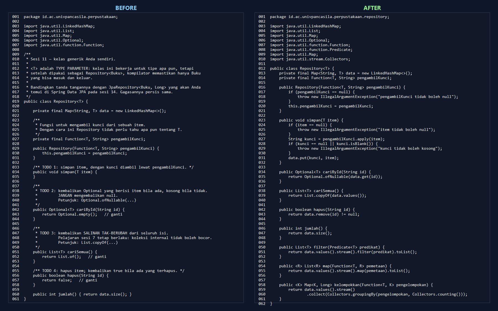
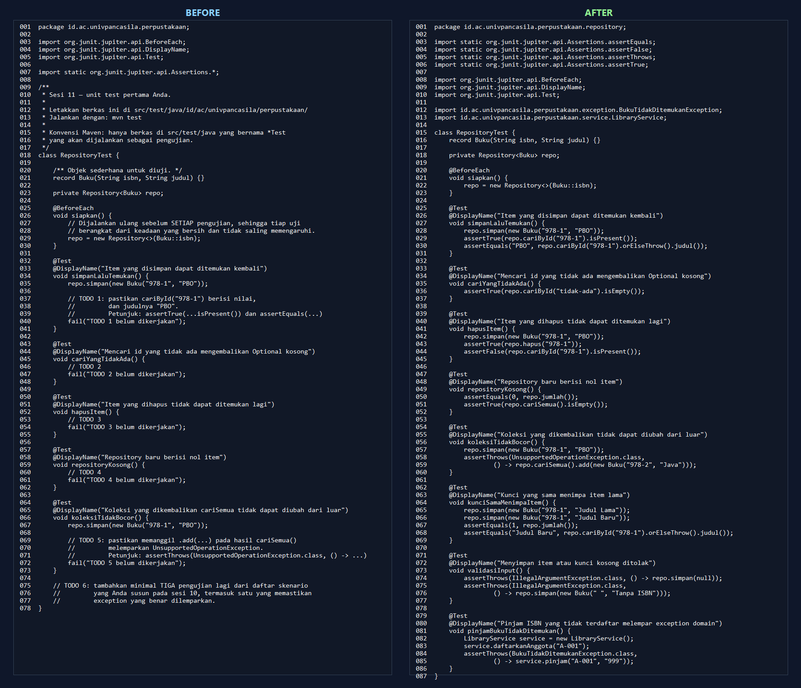
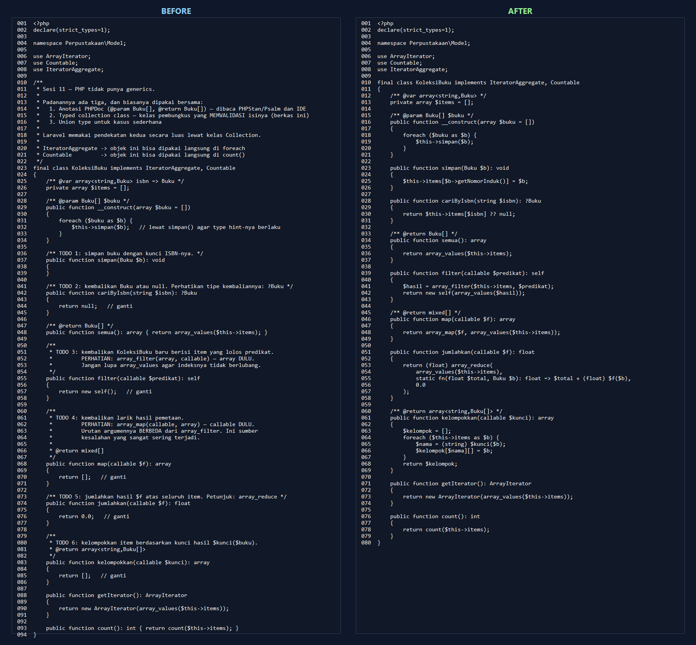
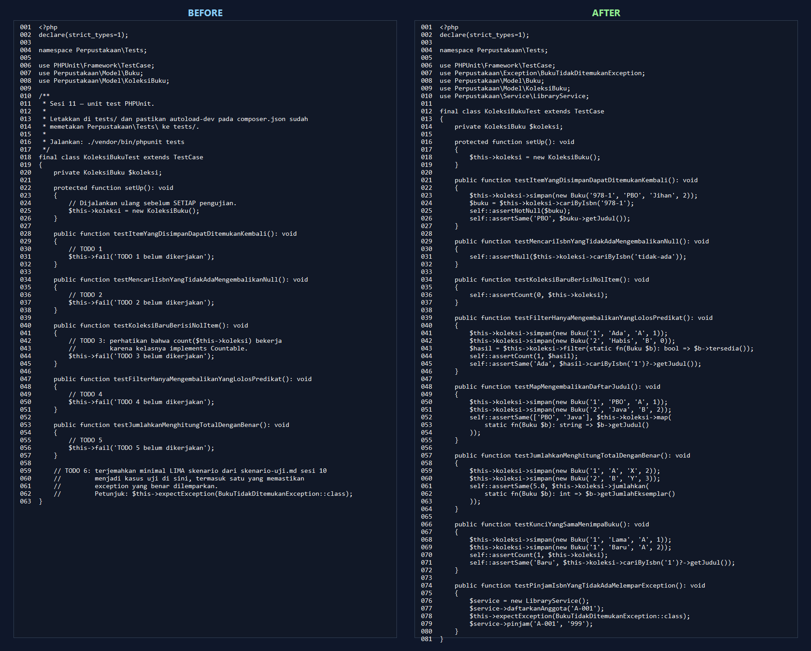
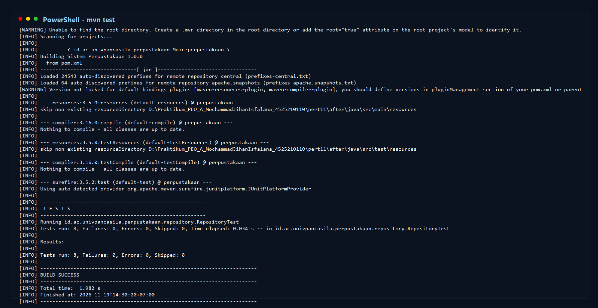
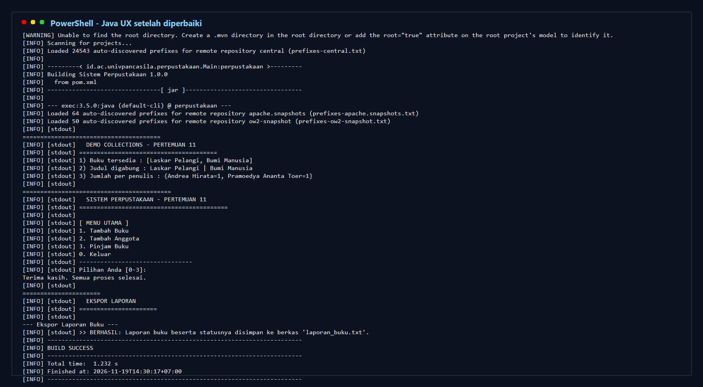
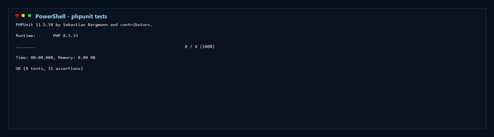
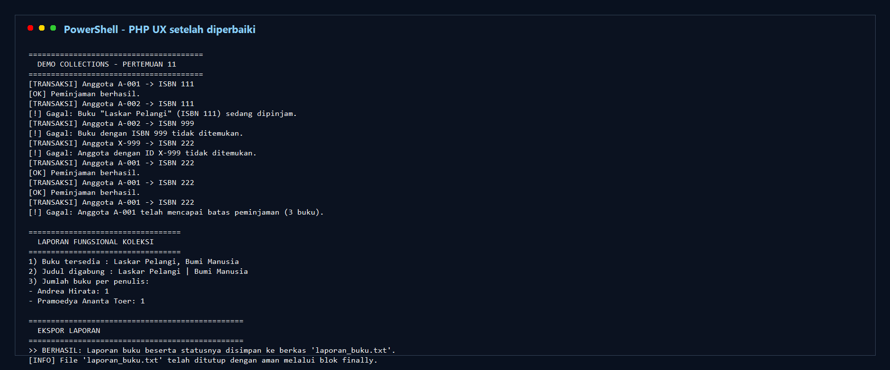

# LAPORAN PRAKTIKUM PEMROGRAMAN BERBASIS OBJEK

| Informasi Praktikan | Keterangan                                        |
| :------------------ | :------------------------------------------------ |
| **Nama**            | Mochammad Jihan Isfalana                          |
| **NPM**             | 4525210110                                        |
| **Kelas**           | A                                                 |
| **Mata Kuliah**     | Praktikum Pemrograman Berbasis Objek (PBO)        |
| **Pertemuan**       | 11 - Collections, Generics, dan Unit Test Pertama |
| **Tanggal**         | Kamis 19 November 2026                            |
| **Versi Java**      | Java 25.0.4.1                                     |
| **Versi Maven**     | Apache Maven 4.0.0-RC7                            |
| **Versi PHP**       | PHP 8.3.33                                        |
| **Versi PHPUnit**   | PHPUnit 11.5.58                                   |
| **Versi Composer**  | Composer 2.10.3                                   |

---

## 1. Deskripsi Pertemuan 11

Pertemuan 11 membahas Collections Framework dan generics pada Java, typed collection pada PHP, Optional/null-safety, operasi fungsional, serta penulisan unit test dengan JUnit 5 dan PHPUnit. Implementasi pada folder `after` merupakan kelanjutan hasil sesi 10 dan mencakup:

- Repository generik Java dengan `Map`, `Optional`, dan koleksi tak-ubah.
- Koleksi typed PHP dengan `filter`, `map`, `jumlahkan`, dan `kelompokkan`.
- Uji JUnit 5 dan PHPUnit minimal delapan skenario.
- Exception domain untuk pencarian ISBN yang tidak ditemukan.
- Pembuktian kegagalan sengaja dan pengembalian kode ke keadaan hijau.
- Simulasi operasi fungsional pada Java dan PHP.

## 2. Struktur Pekerjaan

```text
pert11/after/
├── java/
│   ├── pom.xml
│   ├── src/main/java/id/ac/univpancasila/perpustakaan/
│   └── src/test/java/id/ac/univpancasila/perpustakaan/
├── php/
│   ├── composer.json
│   ├── main.php
│   ├── src/
│   └── tests/
├── sesi-11/
│   ├── pilihan-koleksi.md
│   └── catatan-uji.md
└── images/
```

## 3. Screenshot Source Code Java

### 3.1. Repository.java — before dan after



### 3.2. RepositoryTest.java — before dan after



### 3.3. File Java tambahan

Implementasi Java juga melanjutkan model dan service sesi 10, termasuk `Buku.java`, `LibraryService.java`, dan `Main.java`. Kelas [Repository.java](./java/src/main/java/id/ac/univpancasila/perpustakaan/repository/Repository.java) menambahkan operasi `filter`, `map`, dan `kelompokkan`.

## 4. Screenshot Source Code PHP

### 4.1. KoleksiBuku.php — before dan after



### 4.2. KoleksiBukuTest.php — before dan after



### 4.3. File PHP tambahan

[Buku.php](./php/src/Model/Buku.php) menyediakan data penulis dan status stok; [main.php](./php/main.php) menjalankan demo transaksi serta laporan fungsional; [KoleksiBuku.php](./php/src/Model/KoleksiBuku.php) menjadi typed collection.

## 5. Hasil Output Terminal PowerShell

### 5.1. Java — Unit Test



Hasil akhir:

```text
Tests run: 8, Failures: 0, Errors: 0, Skipped: 0
BUILD SUCCESS
```

### 5.2. Java — Console



### 5.3. PHP — Unit Test



Hasil akhir:

```text
OK (8 tests, 11 assertions)
```

### 5.4. PHP — Console



## 6. Evaluasi UX Console

Evaluasi dilakukan pada alur pengguna Java dan PHP:

- Banner bertingkat digunakan untuk membedakan demo, menu, form, laporan, dan penutup.
- Menu utama Java memakai prompt pilihan pada satu baris dan mengidentifikasi pilihan yang tidak dikenal.
- Form Java memakai label input yang sejajar, pesan `[OK]` untuk berhasil, dan `[!]` untuk dibatalkan.
- Peminjaman Java dapat kembali ke menu dengan `exit` dan menolak input kosong secara eksplisit.
- PHP memakai label `[TRANSAKSI]`, `[OK]`, dan `[!]` agar hasil mudah dibaca.
- PHP menampilkan laporan fungsional bernomor dan bagian ekspor laporan memiliki pembatas jelas.
- Stack trace tidak ditampilkan pada skenario normal; pesan domain tetap menyebut penyebab kegagalan.

Tool skill **ponytail** dan **superpowers** tidak tersedia pada runtime; percobaan pemuatannya sudah dilakukan dan dilanjutkan dengan evaluasi manual berbasis output aktual serta pengujian berulang.

## 7. Dokumen Refleksi

- [Pilihan koleksi dan null-safety](./sesi-11/pilihan-koleksi.md)
- [Catatan kasus uji tersulit](./sesi-11/catatan-uji.md)

## 8. Perintah Verifikasi

```powershell
cd pert11\after\java
mvn test
.\run.bat

cd ..\php
./vendor/bin/phpunit tests
php main.php
```

## Rubrik penilaian sesi ini

| Aspek                     | Bobot | Kriteria                                                                                                                 |
| ------------------------- | ----- | ------------------------------------------------------------------------------------------------------------------------ |
| Kebenaran fungsional      | 35%   | Seluruh perintah pada langkah kerja berjalan dan menghasilkan keluaran yang diminta.                                     |
| Penerapan konsep sesi ini | 30%   | Konsep yang menjadi Sub-CPMK sesi ini diterapkan dengan tepat, bukan sekadar membuat program berjalan.                   |
| Keterbacaan dan konvensi  | 10%   | Penamaan bermakna, format konsisten, komentar seperlunya, riwayat commit wajar.                                          |
| Demo dan pertanyaan lisan | 25%   | Mampu menjelaskan setiap baris kode sendiri dan menjawab pertanyaan demo. MENGGUGURKAN: tanpa demo, tugas tidak dinilai. |

## Pertanyaan demo

> Pertanyaan berikut akan diajukan saat Anda mendemokan pekerjaan sesi ini. Daftar ini sengaja dibuka agar Anda mempersiapkan **pemahaman**, bukan hafalan. Anda boleh memakai alat bantu apa pun saat mengerjakan — tetapi kode yang tidak dapat Anda jelaskan sendiri tidak dinilai.

1. Mengapa Anda memilih Map dan bukan List untuk menyimpan buku? Apa yang berubah dari sisi kecepatan pencarian?
2. Bacakan tanda tangan Repository<T> Anda. Apa arti T di situ? Apa yang terjadi kalau saya mencoba menyimpan objek Anggota ke Repository<Buku>?
3. Mengapa cariById mengembalikan Optional dan bukan null? Tunjukkan satu tempat di kode Anda yang menjadi lebih aman karenanya.
4. Jalankan mvn test sekarang. Berapa uji yang berjalan? Tunjuk satu uji dan jelaskan apa yang sedang dibuktikannya.
5. Saya ubah satu baris di LibraryService sekarang — uji mana yang akan gagal? Mari kita buktikan.
6. Tunjukkan satu skenario dari daftar sesi 10 yang sudah Anda ubah menjadi unit test. Bagaimana bentuknya berubah?
7. Pada kode PHP Anda, apa beda array_map dan array_filter dari sisi urutan argumen? Mengapa itu sering menimbulkan kesalahan?

## Kesalahan yang sering terjadi

| Gejala                                      | Penyebab yang lazim                                                           | Cara memperbaiki                                                                                        |
| ------------------------------------------- | ----------------------------------------------------------------------------- | ------------------------------------------------------------------------------------------------------- |
| mvn test tidak menemukan satu pun uji       | Berkas uji tidak berada di src/test/java, atau namanya tidak berakhiran Test. | Ikuti konvensi Maven: src/test/java dan nama kelas berakhiran Test.                                     |
| PHPUnit: No tests executed                  | Namespace pengujian belum terdaftar di autoload-dev, atau folder tests salah. | Tambahkan autoload-dev pada composer.json lalu jalankan composer dump-autoload.                         |
| ConcurrentModificationException             | Koleksi diubah saat sedang di-iterasi.                                        | Gunakan Iterator.remove(), removeIf(), atau kumpulkan dulu ke koleksi baru.                             |
| json_encode menghasilkan objek, bukan larik | array_filter meninggalkan indeks berlubang.                                   | Bungkus dengan array_values() setelah array_filter.                                                     |
| Uji lulus padahal kode salah                | Assertion terlalu longgar, mis. hanya memeriksa bahwa hasilnya tidak null.    | Periksa nilai yang sesungguhnya diharapkan. Uji yang tidak pernah bisa gagal tidak membuktikan apa pun. |

## Lembar verifikasi demo

Diisi oleh dosen atau asisten pada saat demo. Tugas tanpa lembar terverifikasi tidak dinilai.

|                 |     |
| --------------- | --- |
| Nama / NIM      |     |
| Tanggal demo    |     |
| Nilai sesi ini  |     |
| Catatan penguji |     |
| Paraf penguji   |     |

---

## 9. Penutup

Copyright tugas Mochammad Jihan Isfalana
