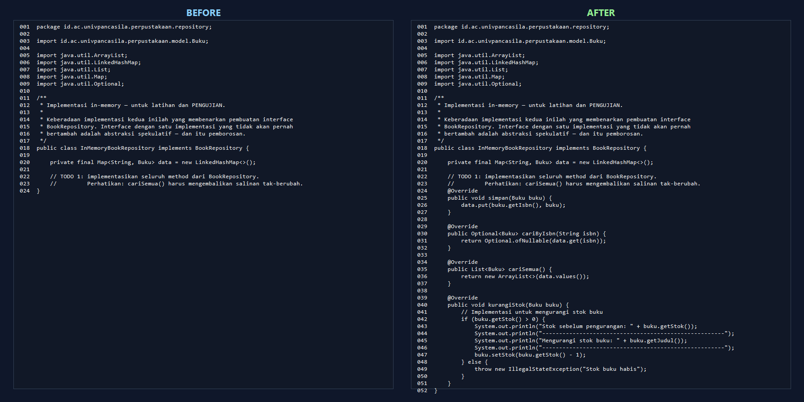
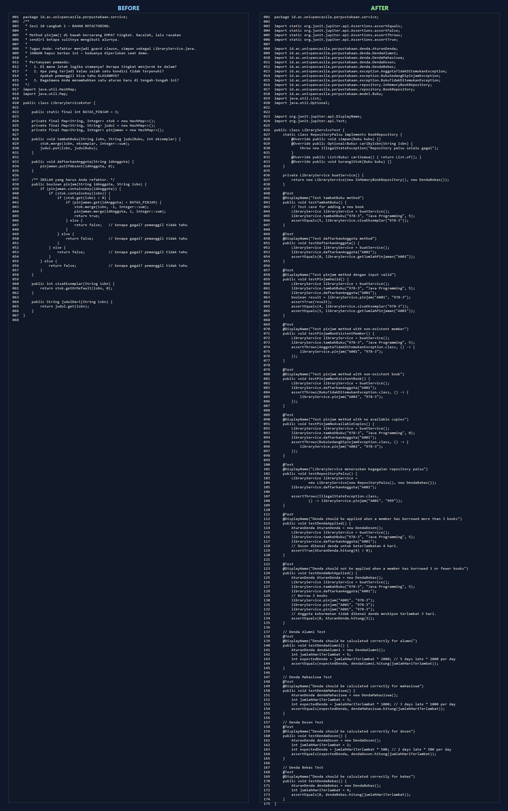
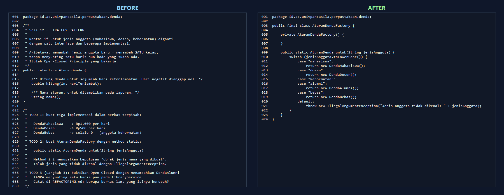
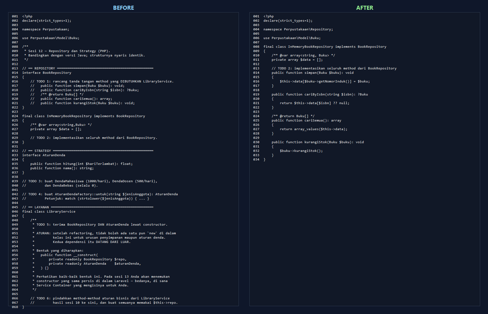
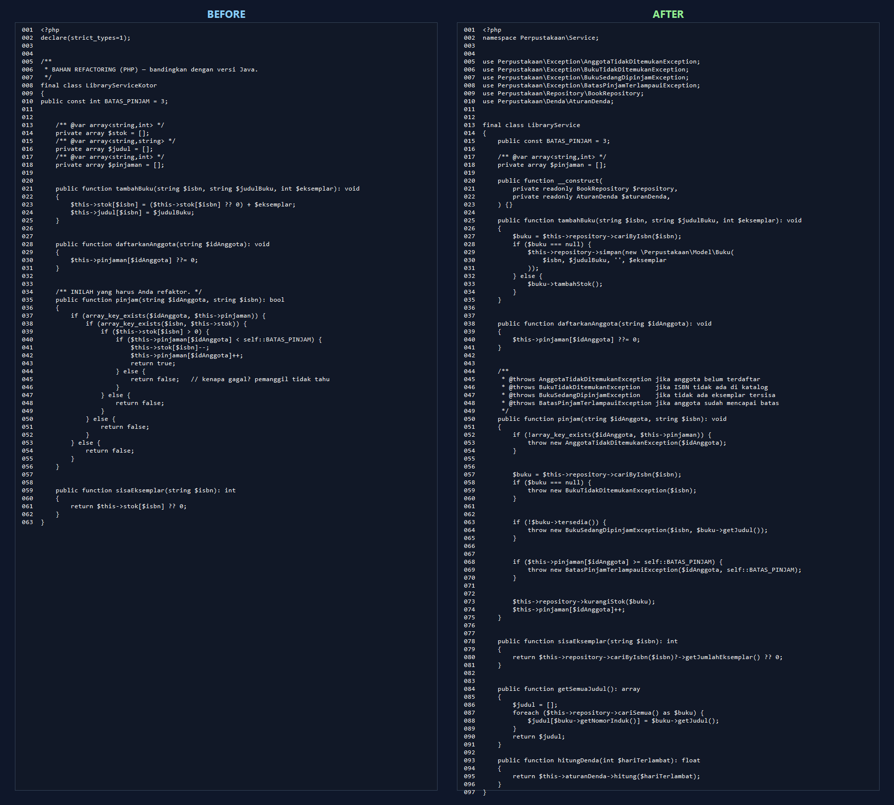
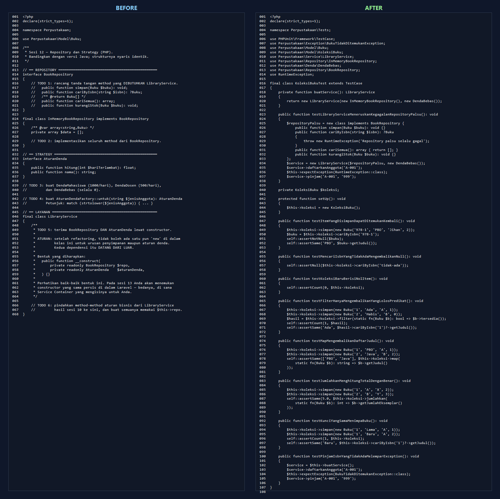
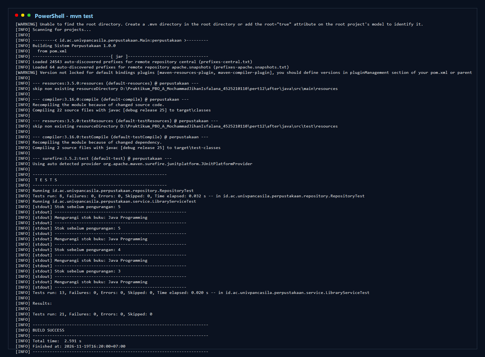
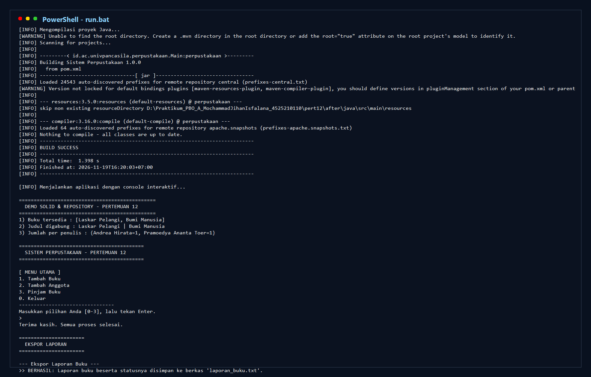
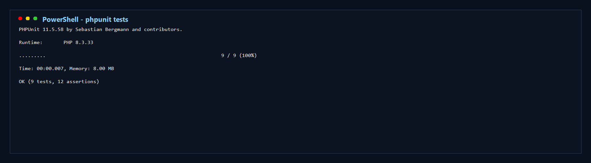
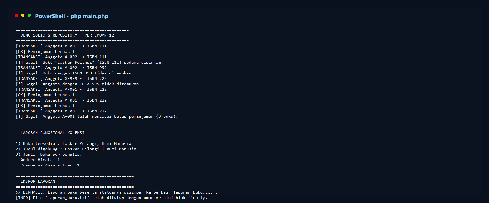

# LAPORAN PRAKTIKUM PEMROGRAMAN BERBASIS OBJEK

| Informasi Praktikan | Keterangan |
| :--- | :--- |
| **Nama** | Mochammad Jihan Isfalana |
| **NPM** | 4525210110 |
| **Kelas** | A |
| **Mata Kuliah** | Praktikum Pemrograman Berbasis Objek (PBO) |
| **Pertemuan** | 12 - Refactoring dengan SOLID dan Repository Pattern |
| **Tanggal** | Kamis 19 November 2026 |
| **Versi Java** | Java 25.0.4.1 |
| **Versi Maven** | Apache Maven 4.0.0-RC7 |
| **Versi PHP** | PHP 8.3.33 |
| **Versi PHPUnit** | PHPUnit 11.5.58 |
| **Versi Composer** | Composer 2.10.3 |

## 1. Deskripsi Pertemuan 12

Pertemuan 12 membahas audit SOLID, pemisahan penyimpanan melalui Repository Pattern, penggantian rantai if denda dengan Strategy Pattern, serta constructor injection manual pada Java dan PHP.

Implementasi mencakup:

- `BookRepository` dan `InMemoryBookRepository`
- `AturanDenda`, implementasi mahasiswa/dosen/bebas/alumni, dan factory
- `LibraryService` yang menerima repository dan aturan denda
- Perakitan dependensi pada titik masuk aplikasi
- Repository palsu untuk pengujian kegagalan penyimpanan
- Dokumen hasil audit [REFACTORING.md](./REFACTORING.md)

## 2. Struktur Folder

```text
pert12/after/
├── java/
│   ├── pom.xml
│   ├── run.bat
│   ├── src/main/java/
│   └── src/test/java/
├── php/
│   ├── composer.json
│   ├── main.php
│   ├── src/
│   └── tests/
├── images/
├── REFACTORING.md
└── README.md
```

## 3. Screenshot Source Code Java — Before dan After

### 3.1. Repository dan implementasinya



### 3.2. LibraryService dan unit test



### 3.3. Aturan denda dan factory



## 4. Screenshot Source Code PHP — Before dan After

### 4.1. Repository PHP



### 4.2. LibraryService PHP



### 4.3. Strategy dan unit test PHP



## 5. Hasil Output Terminal PowerShell

### 5.1. Java unit test



```text
Tests run: 21, Failures: 0, Errors: 0, Skipped: 0
BUILD SUCCESS
```

### 5.2. Java console



### 5.3. PHP unit test



```text
OK (9 tests, 12 assertions)
```

### 5.4. PHP console



## 6. Bukti Refactoring

- **Open-Closed:** menambah `DendaAlumni` tidak mengubah `LibraryService`.
- **Dependency Inversion:** `LibraryService` bergantung pada interface repository dan aturan denda.
- **Pemisahan tanggung jawab:** penyimpanan dipindahkan ke repository, sedangkan perhitungan denda dipisah sebagai Strategy.
- **Pengujian:** terdapat repository palsu yang selalu melempar exception untuk membuktikan isolasi aturan bisnis.

Detail lengkap tersedia pada [REFACTORING.md](./REFACTORING.md).

## 7. Evaluasi Console

- Java menyediakan runner `run.bat` dan tidak bergantung pada pesan Maven `exec:java`.
- Menu Java menggunakan banner, prompt `>`, pesan `[OK]` dan `[!]`, serta input satu baris.
- PHP menampilkan heading bagian, transaksi bernomor, status berhasil/gagal, dan laporan ekspor.
- Pesan kegagalan menyebut penyebab tanpa menampilkan stack trace kepada pengguna normal.

## 8. Perintah Verifikasi

```powershell
cd pert12\after\java
mvn test
.\run.bat

cd ..\php
composer dump-autoload
./vendor/bin/phpunit tests
php main.php
```

## 9. Penutup

Copyright tugas Mochammad Jihan Isfalana
